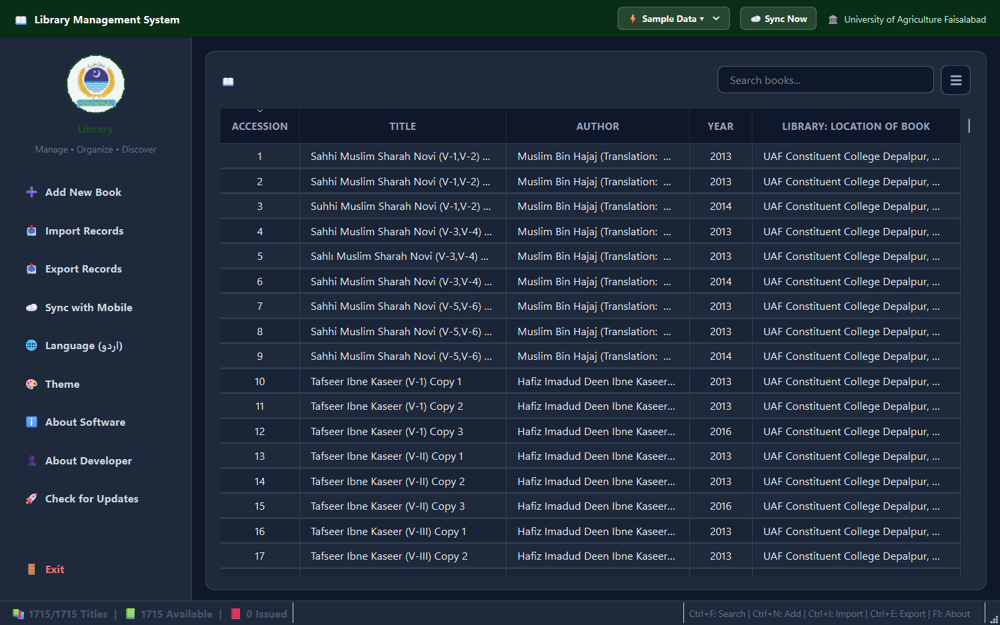
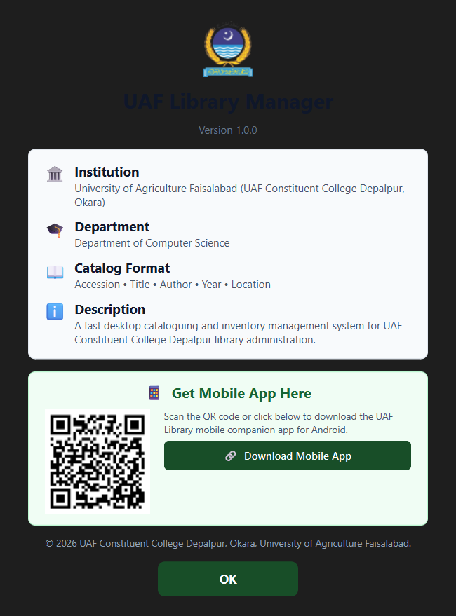
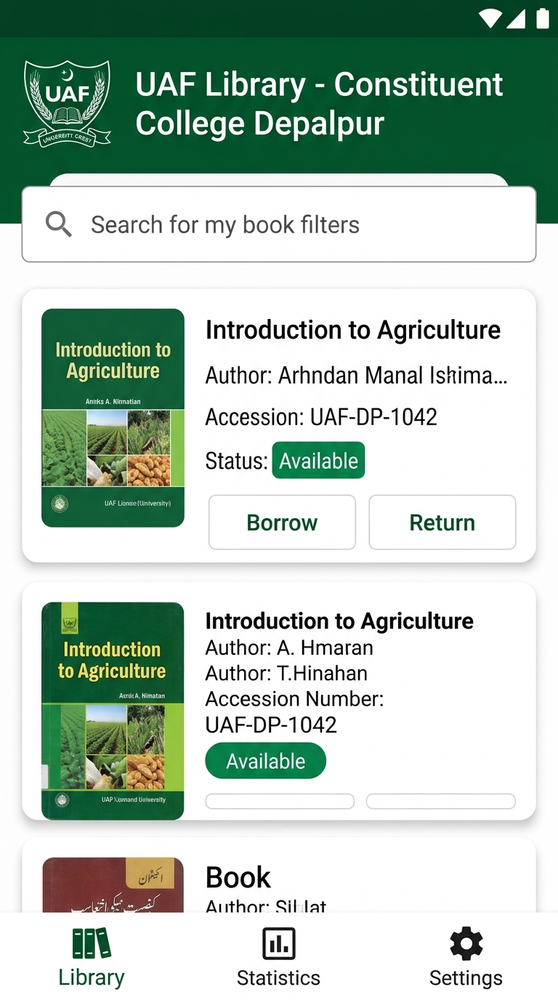
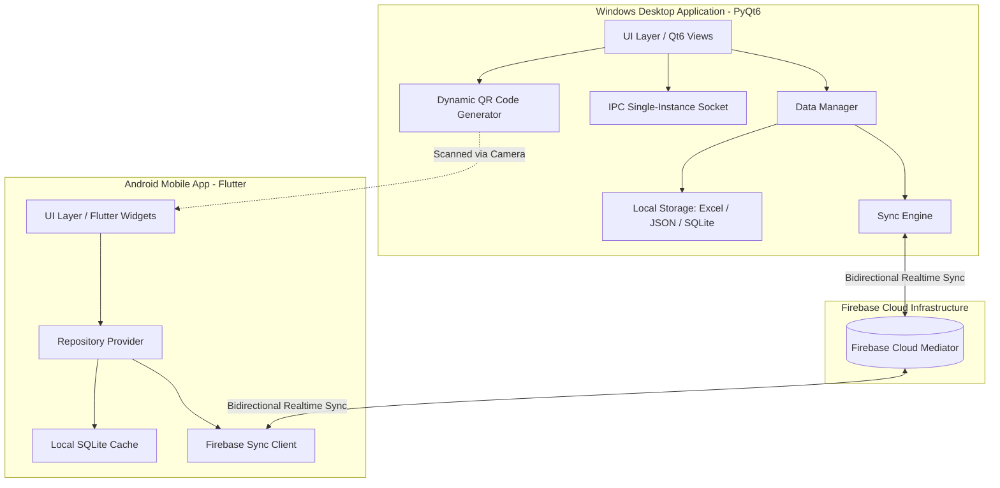

# UAF Library Management System
### University of Agriculture Faisalabad (Constituent College Depalpur, Okara)

A modern, institutional-grade library records and inventory management suite featuring a high-performance desktop administration hub and an offline-first Android companion app connected via cloud synchronization.

 

 

### 📥 Download Official Builds

You can download the compiled applications directly from the [GitHub Releases](https://github.com/Md-Saim/UAF-Library-Management-System/releases/tag/v1.0.0) tab or via the direct download buttons below:

[-005A36?style=for-the-badge&logo=windows&logoColor=white)](https://github.com/Md-Saim/UAF-Library-Management-System/releases/download/v1.0.0/UAFLibraryManager.exe)
&nbsp;&nbsp;&nbsp;&nbsp;
[-0D7377?style=for-the-badge&logo=android&logoColor=white)](https://github.com/Md-Saim/UAF-Library-Management-System/releases/download/v1.0.0/UafLibraryv1.0.0.apk)

---

> [!IMPORTANT]
> **Proprietary Software Notice:**  
> This software is proprietary and developed exclusively for the University of Agriculture Faisalabad (UAF Constituent College Depalpur). This repository hosts official binary distribution releases, documentation, and user guides. The source code is closed-source and not publicly distributed.

---

## 📸 Application Preview

### Desktop Administration Hub
*Comprehensive catalogue management, search, issue tracking, and bulk import/export.*

  

| Cross-Platform Pairing (QR Code) | Mobile Companion Application |
| :---: | :---: |
|  |  |
| *Live QR code generation for instant mobile APK download* | *Fast on-the-go search, status checks, and borrowing* |

---

## 🏛️ System Overview

The **UAF Library Management System** is designed to streamline academic library operations across the campus. It replaces manual ledger books and fragmented spreadsheets with a synchronized digital cataloguing ecosystem.

### Key Capabilities

* **Unified University Catalogue**: Pre-indexed with thousands of institutional books, thesis papers, and curriculum textbooks categorized by department (Agriculture, Computer Science, Sciences, Literature, etc.).
* **Instant Smart Search**: Sub-millisecond indexed searching across accession numbers, book titles, author names, publication years, and library shelf locations.
* **Circulation & Lending Management**: One-click book borrowing and return workflows with real-time status indicators (`Available` vs `Issued`).
* **Multi-Format Ingestion & Export**: Robust bulk import parser for legacy Excel (`.xlsx`), CSV, and delimited formats, with automatic title fallback recovery. Generates structured ReportLab PDF and Excel reports.
* **Bilingual Support & Modern Theming**: Built-in English and Urdu language support with clean dark and light institutional color palettes.

---

## ⚙️ System Design & Architecture

### 1. Windows Desktop Client (`UAFLibraryManager.exe`)
* **Technology**: Python 3.11 with PyQt6 native bindings, compiled into a zero-dependency Windows x64 binary via PyInstaller.
* **Architecture**: Model-View-Controller (MVC) pattern with thread-safe background workers for file I/O and cloud synchronization.
* **Single-Instance IPC Daemon**: Uses `QLocalServer` / `QLocalSocket` to prevent multiple conflicting database instances. Launching a secondary instance automatically brings the existing primary window to the foreground.
* **Cross-Platform Pairing**: Dynamically renders an in-app QR code pointing directly to the mobile APK release for effortless field deployment.

### 2. Android Mobile Companion (`UafLibraryv1.0.0.apk`)
* **Technology**: Flutter framework with Dart native Ahead-of-Time (AOT) compilation.
* **Design Philosophy**: Minimalist institutional aesthetic with tailored 6–8px subtle corner radii, clean typography, and a scale-and-fade university crest splash screen.
* **Offline-First Storage**: Powered by local SQLite caching. Library staff and students can search the entire catalogue and review availability even without an active internet connection.

### 3. Cloud Integration & Firebase Synchronization
* **Cloud Mediator**: Leverages Google Firebase as a scalable real-time synchronization backend.
* **Selective Sync Model**:
  * Bulk institutional records (e.g., 5,000+ base library records) remain compressed and indexed locally for peak performance.
  * Dynamically added books, status changes (`Issued`/`Available`), and borrower logs sync instantly across all connected desktop and mobile terminals.
* **Conflict Resolution**: Timestamp-based Last-Write-Wins (LWW) conflict handling ensures ledger consistency across concurrent updates.
* **Resilient Queue**: Offline updates are held in a persistent local queue and automatically flushed to Firebase once network connectivity is re-established.

---

## 🚀 Installation & Getting Started

### Windows Desktop
1. Download [`UAFLibraryManager.exe`](https://github.com/Md-Saim/UAF-Library-Management-System/releases/download/v1.0.0/UAFLibraryManager.exe).
2. Move the executable to your desired directory (e.g., `C:\Program Files\UAF Library Manager` or your Desktop).
3. Double-click **`UAFLibraryManager.exe`** to launch. No Python runtime or external dependencies required.

### Android Mobile
1. Download [`UafLibraryv1.0.0.apk`](https://github.com/Md-Saim/UAF-Library-Management-System/releases/download/v1.0.0/UafLibraryv1.0.0.apk).
2. Tap the downloaded APK on your Android device.
3. If prompted, allow **Install from Unknown Sources** for your browser or file manager.
4. Launch **UAF Library** and begin exploring the catalog.

---

## 👨‍💻 Author & Institutional Credits

* **Institution:** [University of Agriculture Faisalabad (UAF)](https://uaf.edu.pk)  
  *Constituent College Depalpur, Okara — Department of Computer Science*
* **Lead Architect & Developer:** **Moiz Ud Din Saim**  
  * GitHub: [@Md-Saim](https://github.com/Md-Saim)  
  * Academic Session: 2023–2027

---

Copyright © 2026 University of Agriculture Faisalabad (Constituent College Depalpur). All rights reserved.

